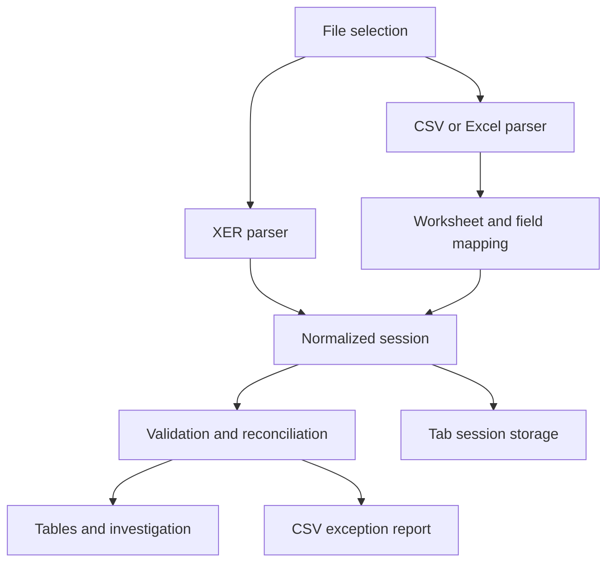

# Technical design

## Architecture
A buildless static application uses browser DOM APIs and a vendored Excel parser. There are no network calls for imported project data. `core.js` exposes `Hub` in the browser and exports the same functions through CommonJS for Node tests.

## Components

- `index.html`: sidebar, header, content region, status region and investigation dialog.
- `app.js`: state ownership, view rendering, handlers, upload reads, Excel worksheet conversion, mapping, import history, persistence and Blob downloads.
- `core.js`: pure transformation and checking functions, with a synthetic fixture generator.
- `style.css`: sidebar layout, metric cards, responsive tables, severity badges and mobile breakpoints.
- `xlsx.full.min.js`: SheetJS CE 0.18.5, bundled locally; no CDN dependency.

## State and logical data model
There is no relational database. The session is serialized under `construction-hub-v1` in sessionStorage.

| Collection | Important fields | Logical identity |
| --- | --- | --- |
| projects | project_id, proj_short_name, source, _row | project_id |
| wbs | project_id, wbs_id, wbs_short_name | project + wbs_id |
| activities | project_id, id, internal_id, name, wbs, start, finish, cost_code | project + activity code; internal ID for relationships |
| relationships | project_id, activity_id, predecessor_project, predecessor_id, type | successor + predecessor + type |
| costs | record_id, project_id, cost_code, description, budget, actual, activity_id, currency | project + record_id |
| commitments | record_id, project_id, cost_code, amount, activity_id, currency, type | project + record_id |
| history | time, name, kind, count, delta, data | ordered import event |
| changes | source, change, record, detail | comparison finding |
| settings | absolute, percent, codeMap, activityMap | current session rules |

Every parser preserves source and line/row where available. History retains complete normalized dataset snapshots for restoration. Latest 12 history entries and latest 1,000 changes are retained. Reconciliation findings are recomputed rather than treated as durable records.

## Import transaction
Read file → parse → map when financial → normalize → compare against previous dataset → prepare candidate state and history → run checks → commit state and findings → persist → render. Parser or reconciliation failures preserve the previously committed dataset, history, findings and storage. Failed worksheet selections restore the previous selection and mapping. Pending financial mapping can be cancelled. Invalid field values may still be imported and then flagged by validation.

## Core functions

| Function | Responsibility |
| --- | --- |
| csv(text) | Quote-aware comma-separated parsing and header/row-width checks |
| xer(text, source) | XER structure parsing and schedule normalization |
| guess(rows, kind) | Suggest mappings from canonical names and aliases |
| finance(rows, kind, map, source, project, currency) | Normalize financial rows |
| validDate(value) | Validate ISO-style dates and optional time |
| amount(value) | Parse monetary text or return null |
| run(session, settings) | Return issues and aggregate comparison groups |
| compare(old, rows, kind) | Identify added, changed and removed records |
| exportCSV(rows) | Escape CSV and neutralize common formula prefixes |
| sample() | Generate the fictional XER and CSV baseline |

## Matching and aggregation
Identifiers are trimmed and uppercased for comparisons. Financial activity references target TASK.task_code, with optional direct source-to-target aliases. Predecessors target TASK.task_id within their respective projects. Code mappings are direct aliases, not transitive graph resolution.

Budget grouping key is project + mapped cost code + currency. Budgets and actuals are summed within this key; commitments are grouped identically. No currency conversion occurs. Commitments without a matching budget key yield an error. The application checks whether an activity's optional cost_code disagrees with a linked financial row.

Tolerance = max(absolute, abs(budget) × percent / 100). Commitment or actual totals strictly above budget + tolerance trigger warnings. Missing/invalid amounts are reported and excluded from sums. A group containing an invalid budget is labelled Invalid budget and over-budget comparisons are suppressed. Duplicate financial records are flagged but retained in aggregates; correction requires replacing the source dataset.

## Revision comparison
Activity identity is project + internal ID; financial identity is project + record_id. Source filename and _row are ignored when comparing content. Added/removed records are detected by identity; modified fields are listed. Duplicate identities can collapse in comparison maps, so revision counts require unique IDs for reliability. Initial imports establish a baseline and do not create added-record differences.

## UI and UX
Seven sidebar views separate ingestion, exploration and findings. Tables provide full-record substring search and 50-row pagination; summary tables display all rows in scrollable containers. Severity badges supplement text labels. An investigation dialog displays the normalized record and remediation direction. Responsive layout collapses the sidebar into horizontally scrollable navigation.

## Important implementation limits

- XER rows must have exactly the declared field count. `%E` is required; records before fields and unknown percent markers fail. A TASK table is required; absence of PROJECT is surfaced through unknown-project checks, rather than a parser rejection.
- XER date selection prefers actual dates, then target dates, then early dates independently for start and finish. This may mix date categories. Dates accept YYYY-MM-DD and optional HH:mm[:ss], with no timezone conversion. Chronological ordering normalizes accepted date-only, space-separated and T-separated values to UTC numeric timestamps without host timezone conversion.
- Standard XER TASK does not universally contain cost_code. No TASKRSRC, resource, UDF or activity-code assignment cost-code extraction is implemented; financial mappings are the primary bridge.
- Some missing schedule names/internal IDs and project/WBS hierarchy problems are not independently validated. External relationships are reported missing when their project/activity is absent.
- Finance maps blank cost record IDs to ROW-n, so stable explicit IDs are preferable for revision comparisons. Blank commitment IDs remain invalid.
- Currency validation checks three uppercase letters, not membership in the ISO currency registry. Currency symbols in numeric strings do not determine currency.
- JavaScript floating point is used; no accounting decimal precision guarantee. Locale decimal commas are unsupported.
- Relationship cycle detection uses an explicit traversal stack, supporting deep graphs without recursive call-stack overflow. File limits do not guarantee bounded runtime or memory.
- Tab storage is convenience persistence, not user authentication or durable storage. History can exceed storage quota; UI reports this while retaining in-memory data.
- No background worker, progress percentage, automated browser suite, server authorization or audit trail is included.

## Suggested production evolution
Split UI and domain modules, add typed schemas and decimal money, move parsing into workers, improve locale/date handling and stable record identity, add per-user authenticated durable storage and audit events, support project-scoped aliases and explicit baseline selection, and test representative real P6 exports. These are future work, not implemented features.
